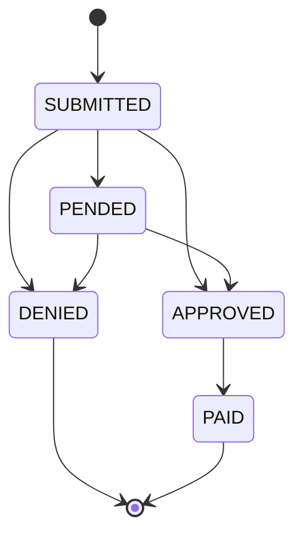

# ClaimPay business rules

ClaimPay is a small, made-up claims and payments app. It exists so the tests in this repo have something realistic to test. All data is synthetic. There is no real patient data and no real payment processing.

These rules are written before the code. The tests check the app against this document, not against whatever the app happens to do.

## 1. Money

All amounts are stored and calculated as whole cents (integers). Rates are stored in basis points (8000 = 80%). There is no floating-point math anywhere in the payment path.

## 2. Roles

| Role | Can do |
|---|---|
| Member | Submit claims for themselves, see their own claims and payments |
| Adjuster | See all claims, make decisions, record payments |

## 3. Access

- A member can only see their own claims. Asking for someone else's claim returns **404**, the same as a claim that doesn't exist, so the API doesn't reveal which claim IDs are real.
- A member who tries to decide a claim or record a payment gets **403**.
- No valid session: **401**.

## 4. Submitting a claim

A claim is accepted only if all of these hold. Otherwise the API returns **400** with a message per field that a member could understand (for example "Billed amount must be between $0.01 and $100,000.00").

| Field | Rule |
|---|---|
| Billed amount | 1 cent to 10,000,000 cents ($100,000.00), inclusive |
| Service date | Not in the future, and not more than 365 days before the submission date |
| Procedure code | One of the codes in the published list (`seed/procedure-codes.json`) |
| Member | Must be active |

## 5. Claim status



Allowed moves:

| From | To |
|---|---|
| SUBMITTED | APPROVED, DENIED, PENDED |
| PENDED | APPROVED, DENIED |
| APPROVED | PAID (only by recording a payment) |

Every other move returns **409**. DENIED and PAID are final.

- A denial needs a reason code.
- An approval needs an approved amount greater than 0 and not more than the billed amount.

## 6. Payment amount

```
payment = max(0, round_half_up(approved_amount × coverage_rate) − copay)
```

- Rounding is to the whole cent, and .5 rounds up.
- With integer cents and basis points: `round_half_up(a × r) = floor((a × r_bp + 5000) / 10000)`.
- The copay comes off after the coverage rate is applied, never before.

Plans:

| Plan | Coverage rate | Copay |
|---|---|---|
| SILVER | 80% (8000 bp) | $20.00 (2000 cents) |
| GOLD | 90% (9000 bp) | $0.00 |

### Worked examples

The tests use this table as the expected result. Values were calculated by hand from the formula above, not taken from the app.

| # | Plan | Approved (cents) | Approved × rate | Rounded | − Copay | Payment (cents) | Why it's here |
|---|---|---|---|---|---|---|---|
| 1 | SILVER | 10000 | 8000.0 | 8000 | 2000 | **6000** | Normal case |
| 2 | SILVER | 12345 | 9876.0 | 9876 | 2000 | **7876** | Odd amount, no rounding |
| 3 | SILVER | 3337 | 2669.6 | 2670 | 2000 | **670** | Rounds up |
| 4 | SILVER | 2501 | 2000.8 | 2001 | 2000 | **1** | Smallest positive payment |
| 5 | SILVER | 2500 | 2000.0 | 2000 | 2000 | **0** | Copay uses up the whole amount |
| 6 | SILVER | 2000 | 1600.0 | 1600 | 2000 | **0** | Would be negative, floored at 0 |
| 7 | SILVER | 10000000 | 8000000.0 | 8000000 | 2000 | **7998000** | Maximum billed amount |
| 8 | GOLD | 10000 | 9000.0 | 9000 | 0 | **9000** | Normal case |
| 9 | GOLD | 2505 | 2254.5 | 2255 | 0 | **2255** | Exactly .5, rounds up |
| 10 | GOLD | 5 | 4.5 | 5 | 0 | **5** | Exactly .5 on a tiny amount |
| 11 | GOLD | 1 | 0.9 | 1 | 0 | **1** | Minimum billed amount |
| 12 | GOLD | 9999 | 8999.1 | 8999 | 0 | **8999** | Rounds down |
| 13 | GOLD | 10000000 | 9000000.0 | 9000000 | 0 | **9000000** | Maximum billed amount |

Rows 3, 4, 9, 10 and 11 are the ones that catch a rounding bug. If the app truncated instead of rounding half up, those rows would each come out 1 cent short.

## 7. Recording a payment

- Only an APPROVED claim can be paid. Paying it moves the claim to PAID.
- Every payment request must include an `Idempotency-Key` header. Without it: **400**.
- Sending the same request again with the same key returns the original payment and does not create a second one.
- Reusing a key for a different claim returns **422**.

## 8. Traceability

- Every request can send an `X-Correlation-Id`. If it doesn't, the API makes one.
- The ID comes back in the response header, appears on every log line for that request, and is saved on the claim or payment it created or changed.
- This is what lets a failure be followed from the browser, through the API log, to the database row.

## 9. Demonstration switches

These are off unless set on purpose. The normal build and CI always run with them off.

| Variable | Effect | Used for |
|---|---|---|
| `DEMO_DEFECT=payment-rounding` | Truncates instead of rounding half up | Showing the payment checks catch a real calculation bug |
| `DEMO_LATENCY_MS=<n>` | Adds a fixed delay of n ms to every API response (max 3000) | Showing the UI tests wait on state, not on timers |
